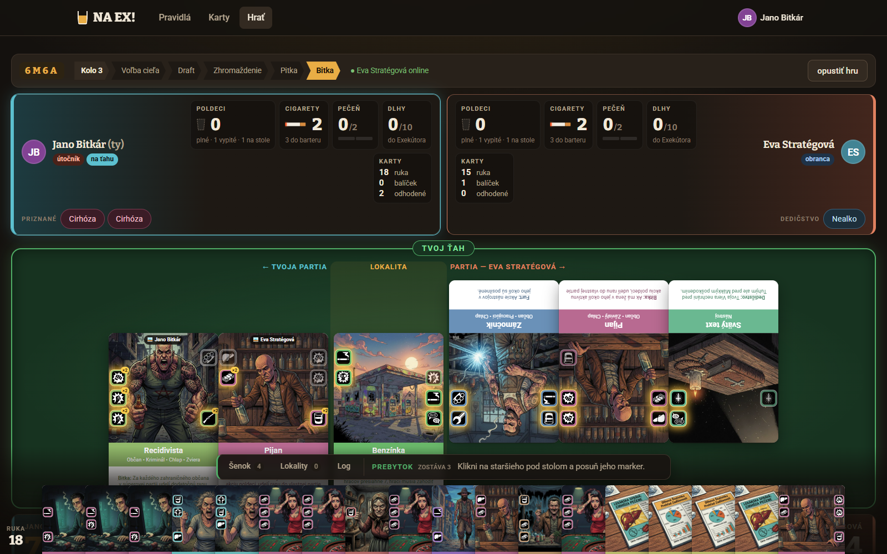
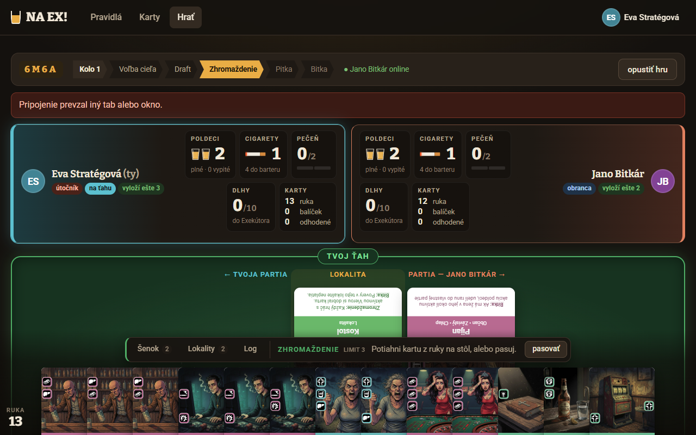
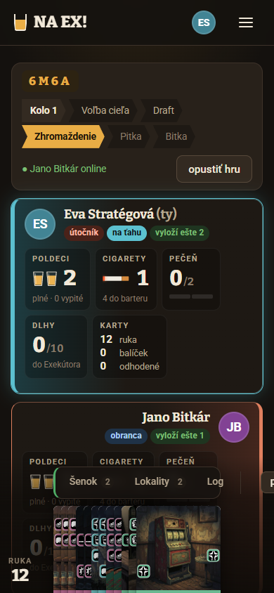
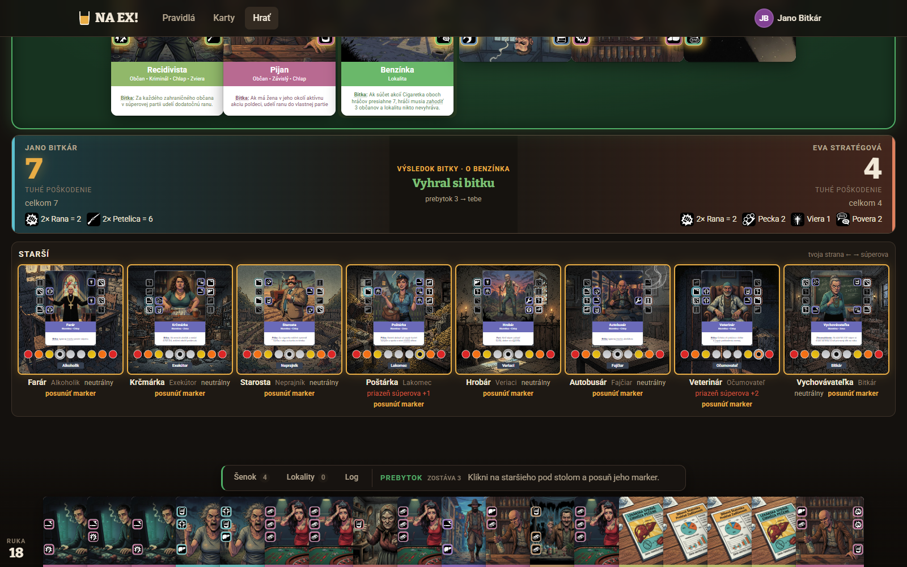
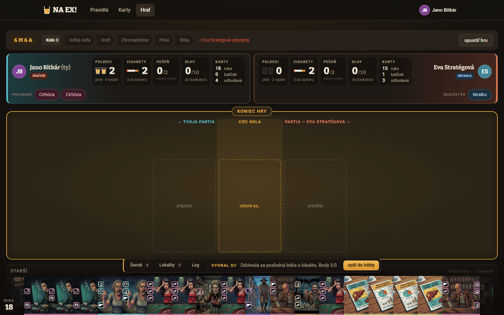

# Playtest 20261011-101224 — Jano Bitkár vs. Eva Stratégová

## Zhrnutie

Partiu vyhral Jano Bitkár (hráč 1, agresívny štýl) **5:0 na body** nad Evou Stratégovou (hráčka 2, opatrná, hrá na body). Išlo o krátku hru: 3 lokality, 3 kolá, každé s jedinou pitkou. Lokality skončili 2:1 pre Jana. Bitky dopadli 4:0, 0:3 a 7:4. Poslednú bitku Jano otočil z 1:4 na 7:4 tým, že dal NA EX na vlastného Recidivistu. Partia tým skončila.

Tri najdôležitejšie zistenia:

1. **NA EX rozhoduje bitky, a nikto pritom dopredu nevie, čo spôsobí.** Na súperovej karte ruší aktívne akcie a zároveň zdvojnásobí neaktívne. Hra nemá náhľad výsledku. Obaja hráči to označili za najväčšiu páku hry aj za najväčšiu nejasnosť.
2. **Krátka hra je na tento systém prikrátka.** Starší, scorecardy, Dlhy, Exekútor, Povera ani Robota sa takmer neuplatnili. Body zo scorecardov hra počas partie neukazuje. Eva si ich musela prečítať v `scorecards.json`.
3. **Päť textových efektov hra nevyhodnotila.** Ide o Pijana, Dievčinu na vydaj, Veterána, Benzínku a Zámočníka. Efekt Benzínky mohol zmeniť výsledok poslednej, rozhodujúcej bitky.

Verdikt: jadro hry (spoje, Vzbura, NA EX) baví a obaja ho považujú za veľmi originálne. Obaja dali originalite 9/10. Zrozumiteľnosť je však najslabšie miesto (priemer 4,5) a rovnováha je druhé (5,0). Rozhranie pôsobí pekne, no rozloženie a mobil sú slabé.

## Partia

| | Hráč 1 | Hráčka 2 |
|---|---|---|
| Meno | Jano Bitkár | Eva Stratégová |
| Štýl | agresívny | opatrná, hrá na body |
| Lokality | Kostol, Benzínka | Lesná cesta |
| Body | **5** | 0 |

- **Dĺžka:** 3 kolá, krátka hra (3 lokality). V reálnom čase 10:12–10:22, teda asi 9,5 minúty. Ťahali AI hráči, preto to nie je ľudský čas.
- **Koniec:** odohrala sa posledná bitka o lokalitu.
- **Pitky:** v každom kole 1/1. Obaja v drafte zakaždým zvolili rovnaký pomer (K1 a K2 0 cigariet / 3 karty, K3 1 cigareta / 2 karty), takže rozdiel nových kariet bol vždy 0.

**Odkiaľ je 5:0.** Hra rozpis nezobrazila, toto je dopočet z koncového stavu a z hodnôt, ktoré si Eva prečítala v `scorecards.json` (znepokojenie 1, strach 2, vydesenie 3, lokality 3, cigarety 1). Jana sa bojí Veterinár (marker 8) a Poštárka (marker 7). Veterinár mu na jeho strane dáva znepokojenie 1 + vydesenie 3, Poštárka znepokojenie 1, spolu 5. Jano teda **nezískal za svoje dve lokality ani bod**: podmienky „lokality" na jeho strane majú Hrobár, Autobusár a Vychovávateľka a tí zostali neutrálni. Všetky body mu priniesol strach starších. Evu sa nebojí nikto, preto má 0.

### Kolo 1 — Kostol (útočí Eva, náhodne)

- Eva si vybrala Kostol kvôli Viere a ochrane pred Poverou. Obaja si zobrali 3 karty a 0 cigariet, takže bola 1 pitka. Jano si zo šenku zobral aj Svokru, ktorú za celú partiu nezahral.
- **Jano:** Pijan – Recidivista – Pijan, teda 3 Rany + Pecka.
- **Eva:** Miňištrant a Dievčina na vydaj, Nealko do Dedičstva. Viera jej išla cez Kostol.
- **Pitka:** Jano dal NA EX na Evin Miňištrant a zrušil jej Vieru. Ako vedľajší efekt jej tým podľa jej denníka zdvojil neaktívne Cigaretky. Eva NA EX vedome nepoužila. Usúdila, že NA EX na Janovu kartu by mu zdvojil neaktívnu Petelicu.
- **Bitka 4:0 pre Jana**, prebytok 4. Jano posunul Veterinára 3× a Poštárku 1× smerom k Eve. Eve tým dal priazeň (Očumovateľ +2), no títo starší sa začali báť Jana. Neskôr práve z toho mal všetky body.

### Kolo 2 — Lesná cesta (útočí Eva ako porazená)

- Draft opäť 3 karty / 0 cigariet, 1 pitka.
- **Jano:** Záhradkár – Veterán. Na spoji sa stretli Odpor + Odpor, čo spustilo **Vzburu** a aktivovalo celú líniu vrátane Petelice. Eva to v spätnej väzbe označila za „výrazný, čitateľný efekt".
- **Eva:** Pijan a 2× Miňištrant, teda dve Viery a Cigaretky. Pred pitkou viedla 3:2.
- **Pitka:** Jano dal NA EX na Miňištrant (#89) a zrušil Vieru. Stav bol 3:3, čo by ako remíza pripadlo útočníčke Eve. Eva potom dala NA EX na Janovho Veterána a zrušila jeho Petelicu, čím stav zmenila na 0:3. Poškodenie pečene z NA EX ide vlastníkovi cieľovej karty, takže **Jano dostal naraz 2 Cirhózy**. Jano sám nevedel, prečo dve. Tipuje, že k tomu prispeli Pečene aktivované Vzburou.
- **Bitka 0:3 pre Evu**, prebytok 3. Dva Miňištranti však zvýšili cenu jedného posunu na 3. Eva tak posunula iba Farára o 1 k Janovi (4 → 3, stále neutrálny). Hra ju na cenu vopred neupozornila. Jej ďalšie dva pokusy o posun skončili hláškou „Nie si na ťahu". Výsledok: Eva vyhrala lokalitu, ale bodovo to nemalo žiadny dopad.

### Kolo 3 — Benzínka (útočí Jano), zlomové kolo

- Jano vybral Benzínku neotočenú, Pohoršenie mal na indexe 1. Obaja si zobrali 1 cigaretu a 2 karty, 1 pitka. Eva pred týmto kolom zámerne čítala `scorecards.json`. Plán: vyhrať s prebytkom bez Miňištrantov a tlačiť Hrobára.
- **Jano:** Pijan a Recidivista, priznal 2× Cirhózu. Priznanie prešlo, aj keď mu z limitu zostávalo 0.
- **Eva:** Zámočník, Pijan a Svätý text (Nástroj vyložený do partie ako zdroj Viery, na ktorý sa NA EX nedá dať). Pred pitkou viedla 4:3.
- **Pitka:** Eva dala NA EX na Janovho Pijana, zrušila mu Rany a viedla 4:1. **Jano dal NA EX na vlastného Recidivistu**, ktorý zdvojnásobil neaktívne akcie: 2× Rana = 2 a 2× Petelica = 6. Výsledok bol **7:4** (2 + 6 − 1 za Evinu Vieru, viď snímka). Hazard zároveň dal Janovi 2 Dlhy a Eve 1. Cirhózu dostal Jano ďalšie 2 a Eva 1.
- Jano Pohoršením posunul Poštárku k Eve. Prebytok 3 použil na Veterinára (na 8, prebudený), Poštárku (na 7) a Starostu.
- Benzínka bola posledná lokalita, takže nasledoval **koniec hry 5:0**. Predtým sa hra ešte pýtala na Liečbu/Pohreb.

Eva v denníku priznáva vlastnú chybu: „nespočítala som pečeňový bonus a posilnenie neaktívnych na súperovej strane; mala som nechať NA EX na rezervu".

## Hodnotenie hry

| # | Kritérium | Jano | Eva | Priemer | Čo k tomu povedali |
|---|---|---|---|---|---|
| 1 | Zábava | 7 | 7 | **7,0** | Skladanie spojov a NA EX ťahy bavia. Eva ako frustrujúce uviedla, že jej NA EX v K1 a K2 zrušil kľúčovú akciu. |
| 2 | Zmysluplné rozhodnutia | 7 | 7 | **7,0** | Strana, poradie, cieľ NA EX a rozdelenie prebytku mali dôsledky. Draft obaja označili za formálny, šenok bol slabý. |
| 3 | Rovnováha a férovosť | 5 | 5 | **5,0** | Remíza pre útočníka a obrovské výkyvy z NA EX (Petelica ×2). Obranca má málo nástrojov. |
| 4 | Náhoda vs. zručnosť | 6 | 7 | **6,5** | Rozhodujú spoje. Jano za čistú náhodu považuje kvalitu šenku a dve Cirhózy v ruke. |
| 5 | Interakcia hráčov | 8 | 8 | **8,0** | NA EX na súperove karty má skutočný a často rozhodujúci vplyv. |
| 6 | Tempo a prestoje | 8 | 7 | **7,5** | Takmer bez čakania. Obaja však hovoria, že je to až príliš rýchle. |
| 7 | Zrozumiteľnosť pravidiel | 5 | 4 | **4,5** | NA EX, limit vykladania, smer priazne pri prebytku, Cirhóza, strany otočenej lokality. Janovi veľmi pomohol výpis ✓/✗/·. |
| 8 | Hĺbka vs. zložitosť | 6 | 7 | **6,5** | Hĺbka tu je, ale je veľa vrstiev a výnimiek (Vzbura, NA EX, priazeň, scorecardy, Pečeň) a v 3 kolách sa nestihnú využiť. |
| 9 | Znovuhrateľnosť | 7 | 7 | **7,0** | Náhodné scorecardy, varianty a lokality sú sľubné. Draft a štart sú však podobné. |
| 10 | Téma a prepojenie | 7 | 8 | **7,5** | Poldeci, pečeň, cirhóza a dlhy sedia. Janovi nebolo jasné, ako do krčmy patria starší a scorecardy. |
| 11 | Napätie a priebeh | 6 | 8 | **7,0** | Obrat 4:1 → 4:7 bol napínavý. Koniec 5:0 však prišiel náhle a bez viditeľných bodov. |
| 12 | Originalita | 9 | 9 | **9,0** | Spoje na indexoch, otáčanie o 180°, Vzbura, dvojaká úloha NA EX a strach starších. |

Celkový priemer: **6,9 / 10**.

**Na čom sa zhodli.** Známky sú takmer totožné, nikde sa nelíšia o viac ako 2 body. Obaja nezávisle uvádzajú tie isté problémy (potvrdzuje to aj organizátor):

- NA EX nemá náhľad a jeho účinok na súperovu kartu je neintuitívny,
- remíza ide útočníkovi,
- textové efekty sa nevyhodnocujú,
- hra skončila po 3 kolách skôr, než sa uplatnili starší a scorecardy,
- šenok je slabý a draft formálny.

Obaja zároveň vysoko hodnotia interakciu (8) a originalitu (9).

**Kde sa líšili:**

- **Napätie (6 vs. 8):** Eva prehrala obratom v poslednej pitke, čo jej pripadalo „napínavé aj nespravodlivé". Jano vyhral, ale koniec mu prišiel náhly a nevidel rozpis bodov.
- **Zrozumiteľnosť (5 vs. 4):** Eva narazila na viac nejasností: cenu prebytku pri Miňištrantoch, komu sa pripisuje pečeň z NA EX a strany lokality.
- **Náhoda (6 vs. 7):** Jano dostal dve Cirhózy naraz a vníma to ako náhodu. Eva hovorí, že ruka je známa celá.

## Karty

**Silné** (zhoda oboch, ak nie je uvedené inak):

- **Recidivista**: Pecka + Petelica na jednej strane, Odpor/Odpor na druhej. S NA EX na vlastnú kartu (Jano) alebo omylom zo strany súpera (Eva) dáva Petelicu ×2 = 6 tuhého. Partiu rozhodla práve táto karta.
- **Pijan**: Rana, Rana vpravo, lacný zdroj dvoch Rán.
- **Veterán + Záhradkár**: Odpor + Odpor spustí Vzburu. Jano spoj Odpor/Odpor považuje za príliš silný, ak sa ho podarí poskladať.
- **Zámočník** (Eva): Pecka na pravej hrane, jej najlepší útok.
- **Svätý text** ako Nástroj vyložený do partie (Eva): dáva Vieru, ktorú NA EX nezruší, lebo NA EX smie len na Občana alebo Starešinu.
- **Miňištrant** (Jano): tri kusy u každého hráča a Viera z nich „dosť zdržovala útok".

**Slabé:**

- **Milujúca manželka** (obaja): Kliatba s efektom „získavaš o jednu cigaretu menej", málo útoku, „pravdepodobne nikdy nehrateľná" (Jano). Jano aj Eva ju mali na konci 2× v ruke.
- **Dievčina na vydaj** (obaja): Dlh ×3 bez útoku. Jano ju mal na konci v ruke 4×.
- **Cirhóza** (Jano): mŕtva karta v ruke, dá sa len priznať.
- **Šarlatán, Finančná poradkyňa, Výherný automat, Noviny, Nealko** (Eva): v bitke nič nerobia. Šenok sa podľa nej „skladal zo zvyškov".
- **Miňištrant** (Jano ho dáva aj medzi slabé): má len Vieru a Cigaretku. Eva navyše zistila, že pri výhre jej predražuje posun markera.

**Rovnováha akcií:**

- Rana, Pecka a Petelica dominujú (obaja). Petelica a Pecka sú vzácne a rozhodujú (Jano).
- Viera je všade: 3 Miňištranti, Svätý text, Kostol (Jano).
- **Povera** takmer nikdy nič neurobila, lebo nikto nemal priznané dlhy. V poslednej bitke mala Eva Poveru 2 bez účinku, čo je vidno aj na snímke. **Robota** nemala čo robiť (Eva).

**Čo je navyše:** Dlh ×3 a Hazard na kartách, ktoré bitku neovplyvňujú (Jano). Viacero identických kópií Šarlatána a Miňištranta (Jano). Povera a Robota v krátkej hre bez dlhov (Eva).

**Čo chýba:**

- **Obrana proti súperovmu NA EX** (obaja). Jediná karta tohto druhu je Svokra („Nástup: Vráť súperovi jedno NA EX z tvojej karty"). NA EX sa však dáva v pitke až po zhromaždení, takže Svokra môže reagovať len v kole s aspoň dvoma pitkami. Tento záver vyplýva z poradia fáz v pravidlách, hráči ho tak nepomenovali. V tejto partii mali všetky kolá jedinú pitku. Jano mal Svokru od 1. kola v ruke a nikdy ju nezahral.
- Viac útočných a zaujímavých kariet v šenku (obaja).
- Náhľad, koľko prebytku zostane po posune (Eva).

**Efekty, ktoré hra nevyhodnocovala** (hlášky „⚠ EFEKT…"):

| Karta | Kde | Efekt | Dopad |
|---|---|---|---|
| Pijan | každé kolo, oba hráči | rana do vlastnej partie, ak má žena v okolí aktívne poldeci | Pijan je jedna z najsilnejších kariet. Jano: „Pijan v mojej línii s manželkou by ma bolel." |
| Dievčina na vydaj | K1 (Eva) | zahodenie karty a dlhov | jej jediný zmysel na stole chýba |
| Veterán | K2 (Jano) | pri influencerovi/žene neplatia pravé/ľavé akcie | Veterán bol súčasťou rozhodujúcej Vzbury |
| **Benzínka** | **K3, posledná bitka** | ak súčet Cigaretiek oboch presiahne 7, lokalitu nikto nevyhráva | **mohol zmeniť výsledok partie**. Z podkladov sa nedá overiť, či súčet 7 presiahol. |
| Zámočník | K3 (Eva) | akcie nástrojov v jeho okolí sú posilnené | Eva čakala posilnenie Svätého textu. Podľa jej denníka však v línii Svätý text – Pijan – Zámočník so Zámočníkom priamo nesusedil, takže nemusel platiť. |

Obaja hráči zhodne hovoria, že bez vyhodnotenia sú tieto efekty „len dekorácia". Nevedeli, či mali ovplyvniť výsledok.

## Vizuálna stránka

| # | Kritérium | Známka | Sledovateľ |
|---|---|---|---|
| V1 | Prehľadnosť stavu hry | **8** | Pás fáz, štítok „TVOJ ŤAH / NA ŤAHU JE…" a odhad bitky. Chýba odlíšenie stavu pripojenia od bannera chyby. |
| V2 | Vizuálna hierarchia | **6** | Stôl prekrýva ruka a lišta. Panely hráčov zaberajú viac miesta ako stôl. |
| V3 | Čitateľnosť kariet | **7** | Lupa je výborná, aktívne akcie majú žltý obrys. Súperove karty sú hore nohami a text starších je drobný. |
| V4 | Spätná väzba | **8** | Rozpis bitky („2× Rana = 2…") je výborný. Záver hry nemá zhrnutie a zmeny zdrojov nemajú animáciu. |
| V5 | Ovládanie a odozva | **6** | Výzva „posunúť marker" je jasná. Akčná lišta však leží cez karty a na mobile je orezaná. |
| V6 | Nápovedy a vysvetlenia | **7** | Pokyn v lište vždy povie, čo robiť. Chýbajú vysvetlivky ikon a hodnoty scorecardov. |
| V7 | Rozloženie a priestor | **4** | Fixná ruka prekrýva stôl, banner posúva obsah, panely hráčov majú rôznu výšku a stôl skáče. |
| V8 | Konzistentnosť | **8** | Farby hráčov, karty, ikony a tlačidlá sú jednotné. „Ty" je vždy vľavo. |
| V9 | Estetika a atmosféra | **8** | Tmavá hospoda, jantárový akcent, ilustrované karty. Záver je plochý. |
| V10 | Prístupnosť a obrazovky | **4** | Mobil (390×844) je prakticky nepoužiteľný. Pri 1280×800 je stôl sotva vidieť. Hráčov odlišuje len farba, bez ikony. |

Priemer: **6,6 / 10**.

**Hlavné problémy a návrhy sledovateľa:**

1. **Ruka a lišta Šenok/Lokality/Log prekrývajú stôl.** Text lokality ani spodok kariet v línii nie je vidieť bez posúvania. Rýchla oprava: spodný padding stola rovný výške ruky a lišty.
2. **Mobil:** pás fáz a panely zaberú celú obrazovku, tlačidlo „pasovať" je mimo obrazovky a ruka sa vrství cez obsah. Väčšia zmena: stôl na celú šírku, zdroje v jednom riadku, ruka ako vyťahovacia zásuvka.
3. **Súperove karty otočené o 180°** sa bez lupy nedajú čítať. Návrh: rám nechať otočený, text vykresliť vždy čitateľne.
4. **Koniec hry:** stôl je prázdny so slotmi „prázdna / vyberá sa…" a výsledok je len malým textom v lište. Návrh: veľká karta „VYHRAL SI / PREHRAL SI" s bodmi a rozpisom.
5. **Panel hráča mení výšku** podľa počtu štítkov. Návrh: pevná minimálna výška.
6. **Pri 18 kartách v ruke** sa karty prekrývajú. Návrh: vejár so zvýraznením a počítadlom.
7. Banner „Pripojenie prevzal iný tab" zmeniť na úzky toast. Podľa organizátora je to pravdepodobne artefakt snímkovania, nie chyba hry. Zostáva len otázka, ako veľmi posúva rozloženie.
8. Krátke animácie zmien (zdroje, posun markera, rana).

Pri 1280×800 je stôl takmer celý prekrytý rukou a lištou. Navrchu je vidieť banner o prevzatí pripojenia:

Mobil: lišta je orezaná, „pasovať" je mimo obrazovky a ruka leží cez panel súpera:

Rozpis výsledku bitky je najlepšia spätná väzba v hre. Vidno z neho aj to, že Cirhóza sa do tuhého nezapočítala a že Evina Povera 2 nemala na čo pôsobiť:

Koniec hry bez zhrnutia:

## Problémy a chyby

### Nejasnosti v pravidlách

- **NA EX na súperovu kartu.** Týka sa oboch hráčov a je to najdôležitejší bod. PRAVIDLA §5 hovorí „vlastnú (posilní) alebo súperovu (zneguje)". Hneď pod tým je však citát „posilňuje (zdvojnásobuje) neaktívne akcie a zároveň ruší aktívne". Hra sa správa podľa citátu, teda aj súperovi zdvojí neaktívne akcie. Jano to nazval „vedľajší efekt, ktorý hráč nečaká". Eva preto v K1 NA EX vôbec nepoužila. Treba rozhodnúť, ktoré znenie platí, a to zjednotiť.
- **Cirhóza: komu pridáva tuhé.** PRAVIDLA §8 ju má vo vzorci tuhé[ja] s otáznikom [?]. Karta hovorí „Obdržíš od súpera dodatočnú ranu". Eva mala dojem, že Janove priznané Cirhózy mu pridali tuhé. Rozpis poslednej bitky na snímke však Cirhózu neobsahuje (2 + 6 − 1 = 7). Hráčka teda nevedela, ako to funguje, a pravidlá to nemajú rozhodnuté.
- **Pečeň z NA EX ide vlastníkovi cieľovej karty.** Je to v súlade s §5, ale pre oboch nečitateľné. Evin NA EX dal Janovi Cirhózu a ona to nečakala.
- **Dve Cirhózy naraz (K2, K3).** Prah je 2 (Alkoholik bez priazne). Jano dostal za dve kolá 4 Cirhózy a nevedel prečo.
- **Prebytok posúva marker k porazenému.** Víťaz tým súperovi pridáva priazeň a sám získava strach, teda body. Je to zámerné napätie (§8), ale ani jednému hráčovi to nebolo zrejmé „bez návodu" (Jano).
- **Limit vykladania.** Jano považoval za chybu, že mohol priznať Cirhózu pri „zostáva vyložiť 0" a že Eva vyložila 3 karty. Podľa §5 sa však priznané karty a Nástroje do limitu nerátajú. **Je to správne, len to rozhranie nevysvetľuje.**
- **Strany lokality po otočení.** Eva nevedela, ktorá hrana patrí komu.
- **Remíza vyhráva útočník.** Obaja to kritizujú. Žiadna bitka sa však nakoniec remízou neskončila. Kritika vychádza z priebežného odhadu („Remíza – vyhrávaš ako útočník", K2 3:3). Treba pripomenúť, že útočník je podľa §7 porazený z minulého kola, takže remíza mu slúži ako dobiehací mechanizmus.

### Odmietnuté ťahy

Žiadny ťah nebol odmietnutý pre chybu hry:

- Jano, K1, `place #55` → „Nie si na ťahu". Jeho vlastná chyba, hral Evin ťah.
- Eva, K2, `place #89` → „Nie si na ťahu" o 10:17:13. Jano pasoval až o 10:17:16 a druhý pokus prešiel.
- Eva, K2, 2× `prebytok farar` → „Nie si na ťahu". Prebytok sa minul po prvom posune, lebo Miňištranti zvýšili cenu na 3. Hra to nehlásila vopred a fázu ukončila bez vysvetlenia.

### Podozrenia na chyby

- **Liečba/Pohreb po poslednej bitke.** Hra sa pýtala, hoci partia už končila (Jano). Je to drobnosť, ale mätie.
- **Odhad bitky nezahŕňa NA EX, ktoré ešte len príde.** Jano videl 3:3 a výsledok bol 0:3. Sám dodal, že Eva hrala po ňom, takže nejde o chybu. Výrazne to však zvyšuje potrebu náhľadu.
- **Eva nevidela dobratie kariet z Cigaretiek** a nebolo jej jasné, prečo ťahala práve 2. Nevedela tiež, čo znamenajú hlášky „Poldeci z NA EX sa vypili; aktívne Poldecko otočili vypité". Z podkladov to nevyzerá ako chyba, skôr ako nečitateľný log.
- **Nevyhodnotené efekty** sú vyššie, najmä Benzínka v rozhodujúcej bitke.
- **Organizátor:** Eva počas hry čítala `packages/core/data/scorecards.json`, aby poznala body za podmienky. Sú to verejné dáta, takže nešlo o podvádzanie. Ukazuje to však, že hra tieto hodnoty hráčovi neukazuje.

## Čo funguje dobre

- **Jadro mechaník.** Spoje kariet na indexoch, otáčanie o 180°, Vzbura a strach starších. Originalita má 9/10 od oboch.
- **Interakcia (8/10).** NA EX, vykladanie do súperovej partie a draft. Zlomové momenty boli NA EX na Miňištrant (K1), NA EX na Veterána (K2) a NA EX na vlastného Recidivistu (K3).
- **Vzbura je čitateľná a efektná.** Eva ju vyzdvihla, hoci bola v súperovej línii.
- **Téma sedí** (poldeci, pečeň, Cirhóza, dlhy). Eva dala 8/10.
- **Tempo.** Takmer bez čakania, jasný koniec.
- **Partia prebehla technicky čisto.** Dohrala sa celá, nikto sa nezasekol a žiadny ťah sa neodmietol pre chybu servera.
- **Rozhranie:**
  - výpis línie s ✓/✗/· (Jano: „veľmi pomohol"),
  - rozpis výsledku bitky,
  - lupa pri prechode myšou nad kartou v ruke,
  - zvýraznenie aktívnych akcií a ×2,
  - pás fáz a online stav súpera,
  - konzistentné farby hráčov a pôsobivá estetika.

## Odporúčania

### Pravidlá a balans

1. **Rozhodnúť, čo robí NA EX na súperovej karte, a zjednotiť znenie v PRAVIDLA §5.**
   - *Prečo:* Je to najväčší výkyv v partii (1:4 → 7:4) a obaja ho uvádzajú ako hlavnú nejasnosť. Špecifikácia si sama protirečí („zneguje" vs. „ruší aktívne a zdvojí neaktívne").
   - *Náročnosť:* rozhodnutie autora. Ak sa zmení správanie, ide o malú úpravu v `effects`/`engine` a testoch.
2. **Ďalší playtest hrať ako strednú hru (6 lokalít).**
   - *Prečo:* Obaja aj organizátor hovoria, že 3 kolá nestačia. Starší, scorecardy, Dlhy, Exekútor, Povera ani Robota sa neuplatnili, takže o ich balanse nevieme nič.
   - *Náročnosť:* žiadna, je to nastavenie partie.
3. **Rozhodnúť otvorenú otázku Cirhózy [?] (§8)** a zvážiť ochranu pred viacerými Cirhózami v jednej pitke alebo jej nejaké využitie.
   - *Prečo:* Jano dostal 4 Cirhózy za 2 kolá a mal ich ako mŕtve karty v ruke. Eva nevedela, či Cirhóza pridáva tuhé jej alebo súperovi.
   - *Náročnosť:* rozhodnutie a malá zmena v engine.
4. **Draft a šenok.**
   - *Prečo:* V tejto partii mal draft vždy symetrický výsledok a 1 pitku. Šenok tvorili hlavne Šarlatáni, Nástroje bez útoku a Dlhy. Obaja ho nazvali formálnym alebo slabým. Pri jedinej pitke navyše nemôže zafungovať Svokra, jediná protizbraň na NA EX.
   - *Náročnosť:* stredná (dáta šenku, prípadne vzorec počtu pitiek). Pred zmenou overiť na viacerých partiách.
5. **Remíza pre útočníka: zatiaľ nemeniť, ale komunikovať.**
   - *Prečo:* Obaja to kritizujú, no reálne sa remíza nestala. Útočník je porazený z minulého kola, takže ide o dobiehací mechanizmus.
   - *Náročnosť:* nízka (text v pravidlách a nápoveda). O zmene rozhodnúť až po ďalších partiách.

### Karty

1. **Vyhodnocovať textové efekty, začať Benzínkou a Pijanom.**
   - *Prečo:* Benzínka môže zrušiť výhru v bitke a v tejto partii bola posledná, rozhodujúca. Pijan je v každom kole na stole u oboch hráčov a je medzi najsilnejšími kartami práve preto, že jeho postih neplatí. Ďalej Veterán (časť Vzbury), Zámočník a Dievčina na vydaj.
   - *Náročnosť:* stredná až vyššia, kód pre každú kartu.
2. **Prehodnotiť slabé karty.** Milujúca manželka a Dievčina na vydaj (štartovacie, obe ich hodnotia ako takmer nehrateľné), Šarlatán, Finančná poradkyňa a Výherný automat (Eva).
   - *Prečo:* Ruky sa na konci partie skladali hlavne z nich (Jano 18 kariet, Eva 15).
   - *Náročnosť:* nízka, úprava dát v tvorcovi.
3. **Pozrieť silu Recidivistu a spoja Odpor/Odpor.** Recidivista s NA EX dal 6 tuhého z jedinej Petelice.
   - *Náročnosť:* nízka (dáta). Odporúčam však overiť až v dlhšej partii, keď bude vyhodnotený aj Pijan.
4. **Zvážiť ďalšiu protizbraň na NA EX**, ktorá funguje aj pri jedinej pitke.
   - *Prečo:* Obaja ju postrádali a Svokra má pri 1 pitke zlé načasovanie.
   - *Náročnosť:* dizajn novej karty.

### Rozhranie

1. **Náhľad výsledku NA EX** („ODHAD BITKY po NA EX" pre každý možný cieľ) a tooltip „ruší aktívne, zdvojnásobí neaktívne".
   - *Prečo:* Je to návrh č. 1 u oboch hráčov. Eva: „bez toho je to hádanie".
   - *Náročnosť:* stredná. Odhad bitky už existuje, stačí ho prepočítať s hypotetickým NA EX.
2. **Ukázať body scorecardov a priebežné skóre počas hry** (koľko by kto mal, keby hra skončila teraz) a rozpis bodov na konci.
   - *Prečo:* Obaja to žiadali. Eva musela čítať JSON a výsledok 5:0 bolo možné pochopiť len dopočtom.
   - *Náročnosť:* stredná.
3. **Prebytok: ukázať cenu jedného posunu** (Miňištrant +1) a koľko zostáva. Pri posune markera napísať, že dáva súperovi priazeň a tebe strach.
   - *Prečo:* Eva prišla o 2 z 3 bodov prebytku bez varovania.
   - *Náročnosť:* nízka.
4. **Rozloženie: ruka a lišta nesmú prekrývať stôl.** Pridať spodný padding a dať panelom hráča pevnú výšku.
   - *Prečo:* sledovateľ, V7 = 4.
   - *Náročnosť:* nízka.
5. **Obrazovka konca hry** s výsledkom, bodmi a ich pôvodom (ktorý starší, ktorá podmienka). Tiež nepýtať sa na Liečbu/Pohreb po poslednej bitke.
   - *Náročnosť:* nízka až stredná.
6. **Vysvetliť v rozhraní, kam ide pečeň z NA EX, prečo vznikla Cirhóza a čo je limit vykladania** (že priznanie a Nástroje sa do neho nerátajú). Pri otočenej lokalite označiť, ktorá strana patrí komu.
   - *Náročnosť:* nízka (texty a tooltipy).
7. **Čitateľný text súperových kariet** napriek otočeniu o 180°.
   - *Náročnosť:* nízka až stredná.
8. **Mobilné rozloženie.**
   - *Prečo:* V10 = 4, na mobile sa hra nedá hrať.
   - *Náročnosť:* vysoká. Odporúčam ju riešiť až po bodoch 1–5.

## Metodika

Dve AI postavy (Jano Bitkár, agresívny štýl, a Eva Stratégová, opatrná, hrá na body) hrali proti sebe cez skutočný server bez znalosti súperovej ruky. Tretí agent, sledovateľ, robil snímky z prehliadača (desktop, 1280×800, mobil 390×844) a hodnotil vizuálnu stránku. Kritériá a zdroje sú v `tools/playtest/kriteria.md`. Podklady:

- `playtest/20261011-101224/` (priebeh.log, denníky, spätné väzby, koncové stavy),
- hodnotenie a poznámky sledovateľa,
- poznámky organizátora,
- na zaradenie postrehov `docs/PRAVIDLA.md`.

**Obmedzenia:**

- Je to **jedna partia**, a navyše krátka hra (3 kolá, každé s 1 pitkou). Závery o balanse kariet a o starších sú predbežné.
- **AI hráči nie sú ľudia.** Hrajú rýchlejšie (asi 9,5 minúty), hru čítajú cez textový výpis a vedia čítať dáta hry (Eva čítala `scorecards.json`). Ich frustrácie a zábava sú len odhadom ľudského zážitku.
- Body 5:0 sú dopočítané z koncového stavu a z hodnôt, ktoré čítala Eva, lebo hra rozpis nezobrazila. Hodnoty v `scorecards.json` sú podľa PRAVIDLA §10 provizórne.
- Banner „Pripojenie prevzal iný tab" je podľa organizátora pravdepodobne artefakt snímkovania.
